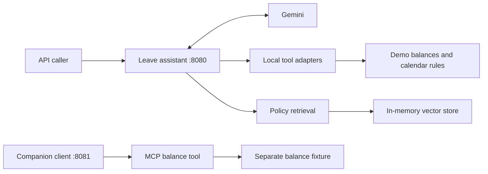

# Employee Leave AI Assistant

A Java learning project that answers employee leave questions using **Spring AI, Gemini, RAG, tool calling, and an MCP server**. Built to understand AI application design and explain the decisions in interviews.

**Example:** “Can John take annual leave from 2026-11-10 to 2026-11-12?” The local assessment endpoint can ask tools for his balance, company rules, and weekday count, then explain the result. It does not book or approve leave.

## Start here

- **[Learning handbook](docs/LEARNING-HANDBOOK.md):** concepts, architecture diagrams, code navigation, tradeoffs, interview questions, and a 15-minute revision route.
- **[Learning roadmap](docs/ROADMAP.md):** eight milestones, exercises, completion criteria, and portfolio evidence.
- **[Experiment log](docs/EXPERIMENTS.md):** record hypotheses, cases, observed results, and lessons.
- **[Companion MCP client](https://github.com/tlsomashekar/employee-leave-mcp-client):** consumes the server’s balance tool from a separate application.

## What is implemented

| Use case | Endpoint | Pattern |
| --- | --- | --- |
| Ask a general question | `GET /ai?message=...` | Model call |
| Extract employee, leave type, dates, and reason | `GET /leave?message=...` | Structured output to a Java record |
| Ask for an employee’s balance | `GET /leave-balance?message=...` | Local tool calling |
| Explain a leave assessment | `POST /leave-assessment` | Multiple local tools |
| Ask about demo policies | `GET /knowledge/ask?question=...` | RAG with an in-memory vector store |
| Discover and invoke a balance tool remotely | MCP Streamable HTTP | `@McpTool` server |



The separate balance fixture is a current limitation. Sharing services between local and MCP adapters is a planned exercise.

## Run locally

Stack: Java 21, Spring Boot 4.1.1, Spring AI 2.0.1, Google GenAI, Spring MVC, Springdoc.

PowerShell, from this repository:

```powershell
$env:GEMINI_API_KEY = "your-api-key"
.\mvnw.cmd spring-boot:run
```

macOS/Linux:

```bash
export GEMINI_API_KEY="your-api-key"
./mvnw spring-boot:run
```

The server uses port **8080**. Startup embeds the sample policy documents, so it requires access to the embedding model and a valid key. The companion client runs on **8081**; start this application first. Open [Swagger UI](http://localhost:8080/swagger-ui/index.html) to try the HTTP endpoints.

```powershell
Invoke-RestMethod 'http://localhost:8080/leave-balance?message=What%20is%20John%27s%20leave%20balance%3F'

$body = @{ message = 'Can John take annual leave from 2026-11-10 to 2026-11-12?' } | ConvertTo-Json
Invoke-RestMethod -Method Post -Uri 'http://localhost:8080/leave-assessment' -ContentType 'application/json' -Body $body

Invoke-RestMethod 'http://localhost:8080/knowledge/ask?question=How%20many%20days%20can%20I%20carry%20forward%3F'
```

Fixture facts: John has 12 annual days, Mary 8, Alex 15; policy documents say annual entitlement is 18 days and carry-forward is at most 5 days. Generated wording may vary. `LeaveRequest` fields are `employee`, `leaveType`, `startDate`, `endDate`, and `reason`.

## Verification and limits

Verified on 1 November 2026: Maven `test` compiled the application on Java 21.0.8 and reported **0 tests executed**. Live Gemini calls and an end-to-end MCP exchange were not verified. There is no quality benchmark yet.

Current gaps: public holidays appear in policy but are not excluded by the calculator; assessment comparisons are model-driven; validation and error handling need work; balances are mocked and duplicated; the vector store is rebuilt at startup; responses do not expose sources; memory and employee authorization are not implemented.

This is a learning project with synthetic HR data. Upcoming milestones are planned work, not completed capabilities.

```powershell
.\mvnw.cmd test
```

The first milestone adds meaningful tests. No passing-test badge or accuracy claim is presented until there is evidence.

## Interview walkthrough

Explain the use case, trace one request using the handbook diagrams, show the code, demonstrate a failure case, then explain what your next experiment would prove. Keep the demo to about five minutes.
