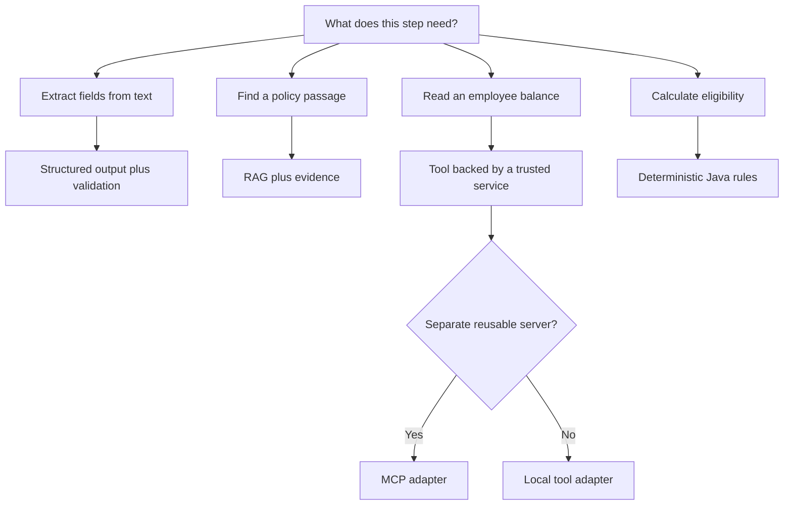
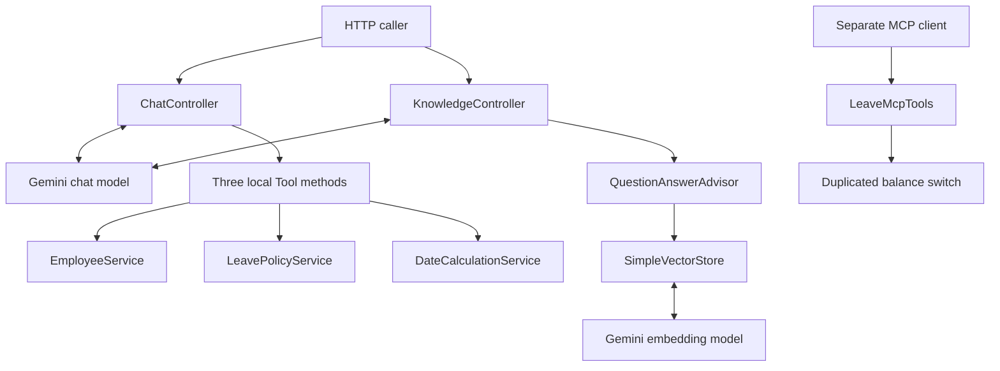
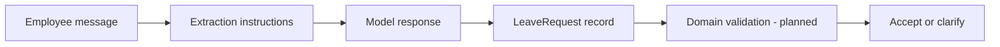
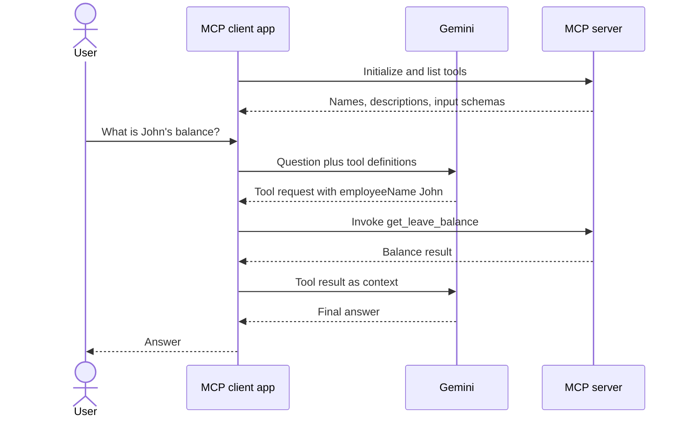
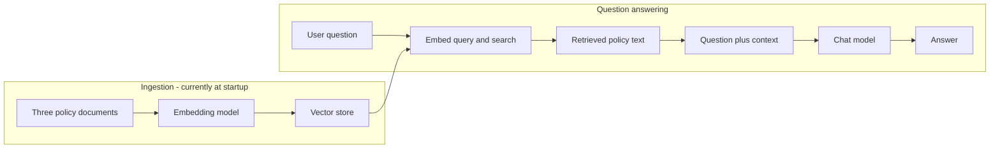
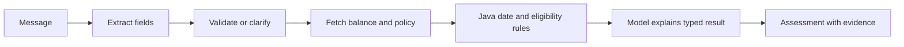

# Employee Leave AI Assistant: learning and interview handbook

One place to revise concepts, trace code, and prepare an honest project explanation. Read the [README](../README.md) for setup and [roadmap](ROADMAP.md) for exercises. Status reflects the source reviewed on 1 November 2026.

## Contents

1. [Project explanation](#1-the-project-in-30-seconds)
2. [Concepts](#2-the-concepts-in-plain-language)
3. [Current architecture and source map](#3-current-architecture)
4. [Structured extraction](#4-structured-extraction)
5. [Tool calling and MCP](#5-tool-calling-and-mcp)
6. [RAG pipelines](#6-rag-two-pipelines)
7. [Planned reliability design](#7-reliability-desired-next-design)
8. [Tradeoffs](#8-tradeoffs-to-defend)
9. [Interview questions](#9-interview-questions-short-answers)
10. [Revision and demo routes](#10-revision-and-demo-routes)

## 1. The project in 30 seconds

“I am building a Java employee-leave assistant to learn AI application engineering. It calls Gemini through Spring AI, extracts structured requests, uses tools for employee facts, retrieves policy context with RAG, and exposes a balance tool over MCP to a separate client. My next milestones are deterministic assessment, tests, and measured evaluations. It uses synthetic data and does not approve or book leave.”

Add personal learning claims after doing the experiments yourself.

## 2. The concepts in plain language

| Concept | Simple meaning | Example here | Common mistake |
| --- | --- | --- | --- |
| LLM | Generates a response from context and learned patterns | Gemini answers `/ai` | Assuming it knows current balances |
| Token | A unit of text processed by a model | Prompt, tools, policy context, output | Treating tokens as words |
| Context window | Bounded capacity for context and generation | Question plus retrieved policy | Adding unlimited history/documents |
| System instruction | Application guidance for model behavior | “Do not invent balances” | Treating guidance as enforced access control |
| Structured output | Map generated content into a defined shape | `LeaveRequest` | Assuming valid JSON means valid dates |
| Tool calling | Model requests a function; application executes it | Fetch John’s balance | Assuming the model executes Java |
| Embedding | Numeric representation useful for comparing meaning | Policy and question vectors | Treating similarity as truth |
| Vector store | Stores/searches embeddings and associated documents | `SimpleVectorStore` | Assuming storage ensures grounded answers |
| RAG | Retrieve relevant context and supply it to the model | Find the carry-forward rule | Confusing retrieval with training |
| MCP | Protocol to discover and invoke server capabilities | Remote balance tool | Assuming it is a model or authorization system |
| Memory | Previous conversation context supplied to future calls | Planned follow-up clarification | Assuming HTTP chat remembers prior requests |
| Evaluation | Repeatable checks against expected behavior | Planned labeled datasets | Judging quality from one good answer |

### Choose the mechanism

This is a design guide. Deterministic eligibility is planned; the current prompt delegates comparison to the model.

## 3. Current architecture

The controller constructs services with `new`. The MCP balance switch is separate from `EmployeeService`. Three policy documents are embedded at startup.

### Follow the source

| Question | Source |
| --- | --- |
| Where are model calls and local tools? | [ChatController](../src/main/java/com/java/example/springai/controller/ChatController.java) |
| What is the extracted schema? | [LeaveRequest](../src/main/java/com/java/example/springai/model/LeaveRequest.java) |
| Where are balances stored? | [EmployeeService](../src/main/java/com/java/example/springai/service/EmployeeService.java) |
| Where are weekends excluded? | [DateCalculationService](../src/main/java/com/java/example/springai/service/DateCalculationService.java) |
| What does policy promise? | [LeavePolicyService](../src/main/java/com/java/example/springai/service/LeavePolicyService.java) |
| What is indexed? | [KnowledgeConfig](../src/main/java/com/java/example/springai/config/KnowledgeConfig.java) |
| How is retrieval attached? | [KnowledgeController](../src/main/java/com/java/example/springai/controller/KnowledgeController.java) |
| What is exposed remotely? | [LeaveMcpTools](../src/main/java/com/java/example/springai/LeaveMcpTools.java) |

## 4. Structured extraction

Input: “John needs annual leave from 2026-11-10 to 2026-11-12.” Expected fields include John, annual leave, and the ISO dates. A reason was not supplied; evaluate that none is invented. Missing-value representation is not an enforced contract yet.

**Remember:** parsing, schema validation, domain validation, and factual correctness are different checks. `2026-02-30` is a JSON string but not a valid date. An end-before-start range can contain valid dates but be invalid for this use case.

**Try:** label 20 messages with missing employees, contradictory dates, and “next Monday.” Define a reference date/timezone for relative dates. Measure each field independently.

## 5. Tool calling and MCP

Successful remote balance path:

**Who executes what?** Gemini selects a tool request. Spring AI and client infrastructure execute it. The server returns data. Gemini composes an answer. The model may choose incorrectly, so evaluate tool selection separately.

**Local versus remote:** `@Tool` integrates local methods with model tool calls. `@McpTool` exposes a capability to MCP clients. MCP adds discovery, schemas, transport, lifecycle, and connection failures to understand.

**Access boundary:** employee authorization belongs in trusted services. A prompt cannot establish the caller’s identity or permissions.

**Try:** compare John, ` JOHN `, unknown, and blank names through both adapters. The current adapters normalize input differently. Record that before unifying them.

## 6. RAG: two pipelines

**Why:** relevant company policy enters context at request time. Retrieval does not update model weights.

**Limits:** retrieval can select irrelevant or outdated passages; generation can misread them. The API currently returns text without source references. Grounding and source presentation need verification.

**Parameters:** chunk size controls the retrieval unit; overlap preserves neighboring context; top-k limits match count; thresholds can reject weak matches; metadata can restrict policy version/type. The current three short documents do not constitute a full chunking pipeline.

**Try:** label the correct document for each question. Measure retrieval hit rate first, then final answer correctness. Include unanswerable questions.

## 7. Reliability: desired next design

This is **planned**. It makes arithmetic and eligibility reproducible while retaining natural language. Manager approval remains separate.

Concrete issue: policy excludes public holidays; the calculator only excludes weekends. Configure a synthetic weekday holiday, demonstrate the failing case, fix it, and retain the regression test. This becomes an interview story with evidence.

## 8. Tradeoffs to defend

| Choice | Learning benefit | Limitation / next decision |
| --- | --- | --- |
| Java / Spring AI | Build on backend skills | Understand the prompt/tool loop behind fluent APIs |
| One HR use case | Compare patterns against the same facts | Fixtures are not a real HR integration |
| In-memory store | Easy setup and inspection | Rebuilds on restart; persistence is a later exercise |
| Separate MCP client | Makes the protocol boundary visible | Two applications to run and test |
| Text tool results | Easy to inspect | Typed results simplify comparison and validation |
| Model-driven assessment | Demonstrates multi-tool reasoning | Authoritative eligibility should use Java rules |

## 9. Interview questions: short answers

1. **Why tools instead of just prompting?** Balances are external facts. A tool fetches application data instead of asking the model to guess.
2. **RAG versus fine-tuning?** RAG retrieves context at request time. Fine-tuning changes model parameters through training. This project has no fine-tuning.
3. **RAG versus tools?** RAG selects document context; tools invoke application capabilities. They can work together.
4. **What does MCP add?** A standard discovery/invocation interface across a client/server boundary. It does not decide permissions.
5. **Is this an autonomous agent?** It demonstrates model-directed tool calls, without a separately designed planner or durable autonomous workflow.
6. **Does structured output prevent hallucination?** No. Well-shaped output can still contain invented facts or invalid values.
7. **How do you test it?** Unit-test Java rules, integration-test MCP/retrieval, and evaluate model output against labeled cases. Avoid exact prose assertions.
8. **What if the provider is unavailable?** Controlled errors and time budgets are needed. Embedding at startup currently affects server availability too.
9. **How do you improve RAG?** Inspect retrieval failures, tune against labeled questions, track policy versions, then evaluate grounded answers.
10. **How do you measure quality?** Extraction accuracy, tool selection/arguments, retrieval hit rate, factual correctness, abstention, latency, and tokens. Scores are not yet measured.
11. **How do you protect balances?** Authenticate callers and authorize access in server-side services before returning data.
12. **What would you change first?** Active domain tests, holiday behavior, shared balance logic, then a baseline evaluation set.

For each answer, open the source or experiment result. Say clearly when a capability is planned.

## 10. Revision and demo routes

**15-minute revision:** 3 minutes concepts; 4 tool/MCP sequence; 3 RAG pipelines; 3 tradeoffs/gaps; 2 explain your latest completed experiment without notes.

**Five-minute demo:** 30 seconds use case; 60 extraction; 60 balance/tool interaction; 60 policy question; 60 tested failure or limitation; 30 next decision. Capture an actual trace before claiming tool invocation. A plausible balance answer alone is not proof of tool use.

**Weekly loop:** explain -> implement one change -> test -> record evidence -> revise the explanation. Commit meaningful increments with the problem and result in the message.

## Official references

Live docs may describe versions newer than pinned Spring AI 2.0.1. Check compatibility before copying APIs.

- [Structured output](https://docs.spring.io/spring-ai/reference/api/structured-output.html)
- [Tool calling](https://docs.spring.io/spring-ai/reference/api/tools.html)
- [MCP client](https://docs.spring.io/spring-ai/reference/api/mcp/mcp-client-boot-starter-docs.html)
- [MCP server](https://docs.spring.io/spring-ai/reference/api/mcp/mcp-server-boot-starter-docs.html)
- [Spring AI project](https://spring.io/projects/spring-ai/)
