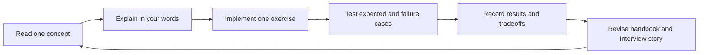

# Learning roadmap: Java AI application engineering

**Purpose:** learn the concepts well enough to implement, debug, and explain them, while building a reviewable GitHub portfolio for Java/backend roles involving AI. This is an educational project. Repository naming or documentation cannot guarantee interview shortlisting.

Start with the [handbook](LEARNING-HANDBOOK.md); use [experiments](EXPERIMENTS.md) to capture evidence. Plan for 5–7 hours a week over eight milestones. Advance when you can explain and demonstrate the result, not because a week has passed.

## Repository identity

| Role | GitHub name | Why |
| --- | --- | --- |
| Main portfolio project | `employee-leave-ai-assistant` | Names the business use case and AI application |
| Companion protocol demo | `employee-leave-mcp-client` | Names the use case and client responsibility |

Keep both existing histories. Keep the current local folder names `springai/` and `mcp-client/` to avoid disrupting IDE paths. They are two repositories, not Maven modules of a root build. Pin the main project on your profile; link the companion from it.

Suggested GitHub topics: main `java`, `spring-boot`, `spring-ai`, `gemini`, `rag`, `tool-calling`, `mcp`, `learning-project`; client `java`, `spring-ai`, `mcp`, `mcp-client`, `tool-calling`, `learning-project`.

## The learning loop

For each milestone produce code, evidence, a small documentation update, and a two-minute explanation. Keep experiments small enough to understand every change.

## Milestones

| Milestone | Learn | Build / exercise | Evidence and interview checkpoint |
| --- | --- | --- | --- |
| 1. Reproducible baseline | Request flow, tokens/context, deterministic rules versus generation | Track wrappers and ignores; align Java 21 configuration; inject services; unify balances; fix holiday mismatch; validate input; add domain tests and CI | Nonzero executed tests without API keys. Explain one bug, its cause, fix, and regression test. |
| 2. Structured extraction | Schemas, parsing, domain validity, ambiguity | Label at least 20 requests; handle missing/invalid fields and relative dates explicitly | Per-field results and clarification behavior. Explain why typed JSON can still be wrong. |
| 3. Tools and assessment | Tool schemas, selection, arguments, execution loop | Typed domain results; Java eligibility service; model explains computed facts | Expected results for sufficient/insufficient balance and invalid requests. Explain who executes tools and owns correctness. |
| 4. MCP | Initialization, discovery, transport, errors | Expose policy/date tools through shared services; integration tests; server-down demonstration | Local/remote result parity and invocation trace. Explain when a protocol boundary is useful. |
| 5. RAG | Embeddings, similarity, chunking, top-k, thresholds, metadata | Ingest versioned policy files; persist index; separate ingestion from serving; expose sources | At least 20 retrieval questions including absent answers; report retrieval hits separately from answer correctness. Explain a failed retrieval. |
| 6. Conversation | Memory scope, state, workflow bounds | Conversation IDs; follow-up clarification; bounded extract/validate/fetch/assess/explain flow | Two conversations remain isolated; missing dates can be supplied later. Explain context growth and state boundaries. |
| 7. Evaluation and failure handling | Regression design, prompt injection, authorization, latency/usage | Controlled errors, time budgets, metrics, synthetic caller permissions; compare a prompt or retrieval change | Before/after report with denominators and limitations; exercise provider/server failures. Explain what prompts cannot enforce. |
| 8. Portfolio presentation | Technical storytelling and tradeoffs | Five-minute real demo; checked setup; architecture review; compare two available model configurations | Another person can run it. Show measured results, source/test links, known gaps, and what you learned. |

All eight milestones are open. Existing source provides a starting point for chat, extraction, tools, RAG, and MCP; it does not mean their milestone criteria are complete.

## Practical test strategy

| Layer | What it proves | When |
| --- | --- | --- |
| Unit | Calendar, validation, domain assessment, shared service behavior | Every commit; no secrets or network |
| Integration | MCP discovery/invocation, retrieval wiring, API errors | Explicit test setup with controlled dependencies |
| Live-model evaluation | Extraction, tool choice, grounded answers, abstention | Opt-in runs with versioned dataset and recorded configuration |

For live results record model, prompt, policy/dataset version, sample count, failures, latency, and tokens. Use human-reviewed expected facts; do not depend entirely on a model grading itself or assert exact generated wording.

Current verified baseline: both applications compiled under Java 21.0.8 on 1 November 2026; each Maven run executed **0 tests**. Live startup, model calls, and end-to-end MCP were not verified. The client compiler reported release 17 despite source/target set to 21.

## GitHub portfolio completion criteria

- [x] Use-case title, concise description, and linked companion project.
- [x] README with setup, examples, implemented features, and limitations.
- [x] Central handbook with source links, Mermaid diagrams, interview questions, revision route.
- [x] Learning roadmap and experiment log template.
- [x] Rename GitHub repositories and set descriptions/topics; verify final URLs.
- [x] Review and include wrappers, wrapper configuration, ignores, and documentation in the portfolio update.
- [ ] Add meaningful tests and CI; only then add an accurate CI badge.
- [ ] Record actual model/tool/retrieval experiments with reproducible cases.
- [ ] Add a short real demo or screenshots showing actual behavior.
- [ ] Keep current and planned architecture visibly separate.
- [ ] Choose a license deliberately if publishing for reuse.
- [ ] Pin the main repository and add a profile description of the project.

## Interview stories to earn through the exercises

1. **Correctness:** holiday policy and date logic disagreed; show how a test exposed it.
2. **Architecture:** two adapters duplicated balances; explain why shared domain services help.
3. **AI quality:** schema-valid extraction failed a labeled case; show the measured improvement.
4. **RAG:** wrong context caused an answer failure; distinguish retrieval from generation.
5. **Distributed systems:** a remote tool failed; explain timeout/error behavior and its test.

Use a simple structure: problem -> evidence -> decision -> result -> remaining limitation. Quantify only measured outcomes. Do not describe unfinished work as production experience.

## First three sessions

1. Read handbook sections 1–5; run both applications yourself and draw the tool loop from memory. Record actual observations.
2. Write calendar tests, reproduce the holiday mismatch, and implement the smallest fix.
3. Unify balance services and compare local versus MCP invocation results; log one tradeoff and one failure.

Save broader tooling, autonomous agents, and model training for later experiments. The current focus is understanding and demonstrating one coherent application.
